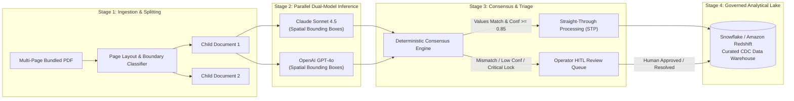

# ConsensusIDP: Enterprise Document Intelligence & Consensus AI Engine

[](demo/index.html)
[](CASE_STUDY.md)
[](LICENSE)
[](#interactive-demo-architecture)

> **Clean-Room Senior Product Manager Portfolio Project**  
> An enterprise-grade Intelligent Document Processing (IDP) platform prototype demonstrating **multi-model consensus (Anthropic Claude Sonnet & OpenAI GPT-4o)**, **spatial coordinate grounding**, and **Human-in-the-Loop (HITL) cognitive fatigue reduction**.

---

## Deliverables in This Repository

1. **[Interactive HITL Demo Application (`demo/`)](demo/index.html):**  
   A zero-backend, client-side web application compatible with GitHub Pages, simulating an enterprise review queue with high-resolution canvas rendering, spatial bounding box overlays, multi-model diff inspection, and curated data warehouse export.
2. **[Comprehensive Senior PM Case Study (`CASE_STUDY.md`)](CASE_STUDY.md):**  
   Detailed product framing covering problem discovery, three-stage architecture trade-offs, empirical DocILE / RealKIE slot-filling evaluations, FinOps unit economics (\$0.034/page), and strategic platform learnings.
3. **[Synthetic Document & Benchmark Generation Suite (`generate/`)](generate/):**  
   Reproducible Python scripts utilizing ReportLab and PyMuPDF to construct mathematically grounded PDFs with pixel-accurate bounding box ground truth.

---

## Key Scenarios Demonstrated

```
                                 ConsensusIDP Review Queue
 ┌───────────────────────┬───────────────────────────────────────────┬───────────────────────────────────────┐
 │ Document Backlog      │ High-Resolution Document Canvas           │ Multi-Model Consensus Inspector       │
 ├───────────────────────┼───────────────────────────────────────────┼───────────────────────────────────────┤
 │ 📁 Lakeside Inn Folio │ [Page 1 of 3]                             │ Field: Assigned Room Number           │
 │   ├─ Child 1: Priya   │  ┌─────────────────────────────────────┐  │   Status: Discrepancy Flag            │
 │   │  (Pages 1–2) [!]  │  │ Lakeside Inn & Conference Center    │  │   Model A (Claude 4.5): 412   [Accept]│
 │   └─ Child 2: Daniel  │  │ Folio LI-20417   Room: [412 / 518]  │  │   Model B (GPT-4o):     518   [Accept]│
 │      (Page 3)    [✓]  │  │                                     │  │   Resolved Value: [ 412 / 518 ] (Editable)│
 │                       │  │ Charges:                            │  │                                       │
 │ 📁 Apex Tax Invoice   │  │   Room Deluxe King:     $180.00     │  │ PM Extraction Analysis:               │
 │   └─ Child 1: INV-0847│  │   Minibar Refreshment:   $14.00 ◄───┼──┼── Hand-corrected strike-through on p.1│
 │                       │  └─────────────────────────────────────┘  │ [ Approve Field ] [ Audit Lineage ]   │
 └───────────────────────┴───────────────────────────────────────────┴───────────────────────────────────────┘
```

### Scenario 1: Lakeside Inn Guest Folios (Hospitality & Multi-Guest Splitting)
- **Document Splitting:** 3-page bundled PDF separated into two discrete guest stays:
  - *Child 1:* Folio LI-20417 for Priya Raman (Pages 1–2; 17 itemized charges across food, beverage, valet, and lodging).
  - *Child 2:* Folio LI-20418 for Daniel Okafor (Page 3; single-night stay with express parking).
- **Edge Cases & Discrepancies:**
  - *Handwritten Strike-through Correction:* Line item #7 minibar fee has a typed \$21.00 struck out with \$14.00 handwritten in blue pen.
  - *Visual Degradation Trap:* A realistic coffee-ring watermark over the guest contact block obscures the phone number.
  - *Room Reassignment Trap:* Guest moved from Room 412 (Page 1) to Room 518 (Page 2), triggering a model divergence flagged for operator review.

### Scenario 2: Apex Global Solutions B2B Invoice (Commercial Procurement)
- **Data Normalization:** Date normalization between European format (`28/03/2026`) and ISO format (`2026-03-28`).
- **Critical Field Guardrails:** Financial liability fields (`Total Due = $14,850.00` and `Bank IBAN`) are hardcoded with mandatory human verification locks.
- **Omission Handling:** Correctly handles optional missing fields (`Purchase Order = null`) without hallucination.

---

## System Architecture



---

## Quick Start (Running the Demo Locally)

The web application is 100% static with **zero backend dependencies**, databases, or build steps.

1. **Clone the repository:**
   ```bash
   git clone https://github.com/anchitshahare/consensus-idp.git
   cd consensus-idp
   ```
2. **Start a local HTTP server:**
   ```bash
   python3 -m http.server 8000 --directory demo
   ```
3. **Open in browser:**
   ```
   http://localhost:8000
   ```

---

## Reproducing the Synthetic Assets

All PDFs, rendered page PNGs, and ground truth bounding boxes can be regenerated deterministically:

```bash
# 1. Create and activate a clean virtual environment
python3 -m venv venv
source venv/bin/activate

# 2. Install generation dependencies
pip install -r generate/requirements.txt

# 3. Generate Scenario 1 (Lakeside Inn Folios)
python3 generate/gen_lakeside_inn.py

# 4. Generate Scenario 2 (Apex B2B Invoice)
python3 generate/gen_apex_invoice.py

# 5. Compile mock data schema for web application
python3 generate/build_mock_data.py
```

---

## Directory Structure

```
consensus-idp/
├── demo/                           # Interactive Web Application (GitHub Pages ready)
│   ├── index.html                  # Responsive 3-pane layout shell
│   ├── css/
│   │   └── style.css               # Bounding box highlighting & pulse animations
│   ├── js/
│   │   ├── mockData.js             # Preloaded recorded extractions & coordinate schemas
│   │   ├── state.js                # Reactive in-memory state engine with localStorage sync
│   │   ├── consensus.js            # Multi-model diff inspector & lineage audit drawer
│   │   ├── viewer.js               # Document canvas viewer with zoom/fit & spatial overlays
│   │   └── app.js                  # Main controller, filters, and warehouse preview
│   └── assets/                     # Rendered high-res PNGs and synthetic PDFs
│       ├── lakeside-inn/           # Page-1.png, page-2.png, page-3.png
│       └── apex-invoice/           # Page-1.png
├── generate/                       # Python Asset Generation Pipeline
│   ├── requirements.txt            # reportlab, pymupdf, Pillow
│   ├── gen_lakeside_inn.py         # Multi-page folio PDF & bounding box generator
│   ├── gen_apex_invoice.py         # B2B invoice PDF & bounding box generator
│   └── build_mock_data.py          # Formatter compiling recorded model outputs
├── CASE_STUDY.md                   # Comprehensive Senior PM Case Study (DocILE, FinOps, UX)
├── LICENSE                         # MIT License
└── README.md                       # Project Overview & Quick Start Guide
```

---

## Clean-Room Implementation & Disclaimer

- **Zero Proprietary Data:** All documents, names (Priya Raman, Daniel Okafor), addresses, company names (Lakeside Inn, Apex Global Solutions), tax IDs, and transaction amounts are 100% synthetically generated for demonstration purposes.
- **Preloaded Model Extractions:** Model outputs from Anthropic Claude Sonnet 4.5 and OpenAI GPT-4o are preloaded recorded outputs; this demo executes **zero live inference API calls** and requires no credentials or tokens.
- **Independent Portfolio Project:** Authored as an independent demonstration of Senior Product Management, AI system design, evaluation methodology, and human-in-the-loop interaction patterns.

---

## License

This project is open-source under the [MIT License](LICENSE).
