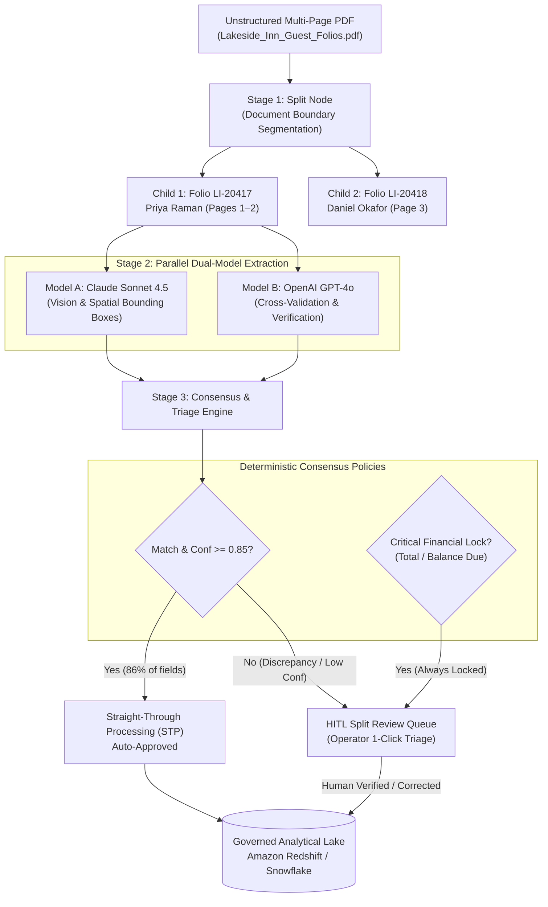

# ConsensusIDP: Enterprise Document Intelligence Platform

[](https://anchitshahare.github.io/consensus-idp/)
[](CASE_STUDY.md)
[](LICENSE)
[](#quick-start)

> **Senior Product Manager Portfolio Project**  
> An enterprise-grade Intelligent Document Processing (IDP) platform that transforms unstructured, multi-page PDF documents into governed, schema-validated analytical data assets using **dual foundation model consensus (Anthropic Claude Sonnet 4.5 & OpenAI GPT-4o)**, **spatial coordinate grounding**, and **cognitive-fatigue-reduced Human-in-the-Loop (HITL) review**.

---

## Live Interactive Walkthrough

The project is hosted live as a zero-dependency, client-side web application on GitHub Pages:

👉 **[Launch ConsensusIDP Live Demo](https://anchitshahare.github.io/consensus-idp/)**

---

## Product Overview & The 7-Step User Journey

Unlike generic single-screen extraction forms, **ConsensusIDP** models the complete lifecycle of enterprise document intelligence across a guided 7-screen narrative:

```
┌─────────────┐     ┌─────────────┐     ┌──────────────┐     ┌─────────────┐
│ 1.Workspace │ ──> │  2.Schema   │ ──> │ 3.Workflow   │ ──> │  4.Upload   │
│   Project   │     │  Definition │     │  DAG Builder │     │   Source    │
└─────────────┘     └─────────────┘     └──────────────┘     └─────────────┘
                                                                    │
┌─────────────┐     ┌─────────────┐     ┌──────────────┐            │
│  7.Output   │ <── │ 6.HITL Split│ <── │  5.Pipeline  │ <──────────┘
│   Dataset   │     │   Review    │     │   Run (3s)   │
└─────────────┘     └─────────────┘     └──────────────┘
```

### 1. Workspace Isolation
Create and manage multi-tenant operational workspaces. Each workspace encapsulates document schemas, DAG pipelines, ingestion sources, and audit logs.

### 2. Target Schema Builder
Define extraction attributes (e.g., `guest_name`, `folio_number`, `room_number`, `total_amount`). Includes inline data type configuration (`VARCHAR`, `DECIMAL`, `DATE`), required constraints, and a live reactive `schema.json` preview pane.

### 3. Workflow & DAG Builder
Visually construct a 2-stage execution DAG:
- **Node 1 — Split Node:** Defines page boundary rules (e.g., Child 1: Pages 1–2; Child 2: Page 3) to segment bundled multi-stay or multi-invoice packages before inference.
- **Node 2 — Extraction Node (Dual LLMs):** Configures parallel foundation models:
  - **Anthropic Claude Sonnet 4.5:** Primary vision extractor for dense tabular charges and normalized spatial bounding boxes (`[ymin, xmin, ymax, xmax]`).
  - **OpenAI GPT-4o:** Independent secondary extractor for cross-validation and numeric trap detection.
  - **Consensus Policy:** Sets the auto-approval threshold (default: &ge; 0.85 confidence match).

### 4. Document Ingestion
Select source documents pre-loaded with enterprise stress-test edge cases (`Lakeside_Inn_Guest_Folios.pdf` — 3-page bundled folio):
- Multi-guest bundled stay separation (Priya Raman vs. Daniel Okafor).
- 17 itemized room charges across multiple pages.
- Visual coffee-ring watermark obscuring contact phone block.
- Handwritten blue pen strike-through correction (\$21.00 typed struck out with \$14.00 written).
- Mid-stay room transfer trap (Room 412 on Page 1 &rarr; Room 518 on Page 2).

### 5. Timed Pipeline Run (3-Second Animation)
A simulated real-time terminal log demonstrating the full processing pipeline:
1. `0.4s`: Document boundary segmentation generates 2 child records.
2. `1.2s`: **Pass 1 Raw Extraction:** Dual LLMs extract raw key-value pairs (51 total keys).
3. `1.9s`: **Pass 2 Schema Extraction:** Target schema mapped using raw extractions as input.
4. `2.5s`: **Consensus Engine:** Compares dual-model extractions:
   - **44 fields auto-approved** (&ge; 0.85 exact match) &rarr; Streamed directly to simulated Redshift.
   - **7 fields flagged** (mismatches, low confidence, critical locks) &rarr; Routed to the HITL review queue.

### 6. Human-in-the-Loop (HITL) Review Queue
A split-screen workspace designed to eliminate reviewer cognitive fatigue:
- **Left Panel (PDF Document Canvas):** Page navigation strictly constrained to the selected child document (`Page 1 of 2 · PDF p.1`). Bounding boxes render on the active field with smooth centering. Supports zoom, fit, and an outline toggle.
- **Right Panel (Field Review & Inspector):**
  - **"Needs Review" Default Tab:** Reviewers only see the 7 flagged items, ignoring the 44 auto-approved fields.
  - **Focused Field Inspector:** Selecting any row reveals side-by-side extractions from Claude Sonnet 4.5 and GPT-4o, model confidence scores, and a **PM Root Cause Analysis** note explaining the underlying document nuance.
  - **1-Click Resolution & Manual Override:** Single-click `[Accept Claude]` or `[Accept GPT-4o]`, or enter an inline correction.
  - **Critical Field Guardrails:** Financial liability fields (`total_amount_due`, `balance_due`) are locked with mandatory human sign-off; automated bulk approval is prevented.
  - **Publish Gate:** The "Publish to Dataset" button remains disabled until all pending items in the active child are resolved.

### 7. Curated Output Dataset (Amazon Redshift / Snowflake)
Displays the final relational dataset exported via Change-Data-Capture (CDC):
- Unifies columns across all records so no attribute is omitted.
- Displays synchronization status (`PUBLISHED` vs. `PENDING_REVIEW`) and CDC timestamps.
- Drill down into audit lineage (model attribution, normalized bounding coordinates, and approval timestamps).

---

## System Architecture



---

## Directory Structure

```
consensus-idp/
├── .github/
│   └── workflows/
│       └── deploy.yml              # Automated GitHub Pages CI/CD workflow
├── demo/                           # Interactive Web Application
│   ├── index.html                  # Responsive 3-pane shell
│   ├── css/
│   │   └── style.css               # Clean typography, bounding box outlines, animations
│   ├── js/
│   │   ├── mockData.js             # Preloaded recorded extractions & coordinate schemas
│   │   ├── state.js                # Reactive in-memory state engine with localStorage sync
│   │   ├── router.js               # Multi-screen router & progress navigation controller
│   │   ├── app.js                  # Application bootstrap & error boundary
│   │   └── screens/
│   │       ├── s1-workspace.js     # Screen 1: Workspace creation & card list
│   │       ├── s2-schema.js        # Screen 2: Schema definition & live JSON preview
│   │       ├── s3-workflow.js      # Screen 3: 2-Node DAG builder & model selector
│   │       ├── s4-upload.js        # Screen 4: Pre-loaded document selection
│   │       ├── s5-run.js           # Screen 5: 3-Second animated pipeline terminal
│   │       ├── s6-hitl.js          # Screen 6: Split-screen PDF viewer & review inspector
│   │       └── s7-dataset.js       # Screen 7: Redshift analytical table & CDC export
│   └── assets/                     # High-resolution rendered page PNGs & synthetic PDFs
│       └── lakeside-inn/           # page-1.png, page-2.png, page-3.png
├── generate/                       # Python Asset Generation Pipeline
│   ├── requirements.txt            # reportlab, pymupdf, Pillow
│   ├── gen_lakeside_inn.py         # Multi-page folio PDF & bounding box generator
│   └── build_mock_data.py          # Script compiling recorded model outputs
├── index.html                      # Root redirect to demo/
├── CASE_STUDY.md                   # Comprehensive Senior PM Case Study (DocILE, FinOps, UX)
├── LICENSE                         # MIT License
└── README.md                       # Project Overview & User Guide
```

---

## Quick Start (Running Locally)

The web application is 100% static with **zero runtime dependencies**, databases, or build steps.

1. **Clone the repository:**
   ```bash
   git clone https://github.com/anchitshahare/consensus-idp.git
   cd consensus-idp
   ```
2. **Start a local HTTP server:**
   ```bash
   python3 -m http.server 8000 --directory demo
   ```
3. **Open in your browser:**
   ```
   http://localhost:8000
   ```

---

## Reproducing the Synthetic Assets

All PDFs, rendered page PNGs, and ground truth bounding boxes can be regenerated deterministically:

```bash
# 1. Create and activate a clean virtual environment
python3 -m venv venv
source venv/bin/activate

# 2. Install dependencies
pip install -r generate/requirements.txt

# 3. Generate Lakeside Inn synthetic 3-page folio
python3 generate/gen_lakeside_inn.py

# 4. Compile mock data schema for the web application
python3 generate/build_mock_data.py
```

---

## Clean-Room Implementation & Disclaimer

- **Zero Proprietary Data:** All documents, names (Priya Raman, Daniel Okafor), hotel entities, tax IDs, and transaction amounts are 100% synthetically generated clean-room assets.
- **Preloaded Model Extractions:** Extractions from Anthropic Claude Sonnet 4.5 and OpenAI GPT-4o are recorded outputs; this demo executes **zero live inference API calls** and requires no private credentials.
- **Independent Portfolio Project:** Authored as an independent demonstration of Senior Product Management, AI system design, evaluation methodology, and human-in-the-loop interaction design.

---

## Accompanying Product Case Study

For an in-depth breakdown of product strategy, DocILE / RealKIE slot-filling evaluation benchmarks (Run 5.2 micro-averaged F1 of 72.3% and the bimodal distribution discovery), FinOps unit economics (\$0.034/page), and shipped vs. prototype capability matrices, see **[CASE_STUDY.md](CASE_STUDY.md)**.

---

## License

This project is open-source under the [MIT License](LICENSE).
